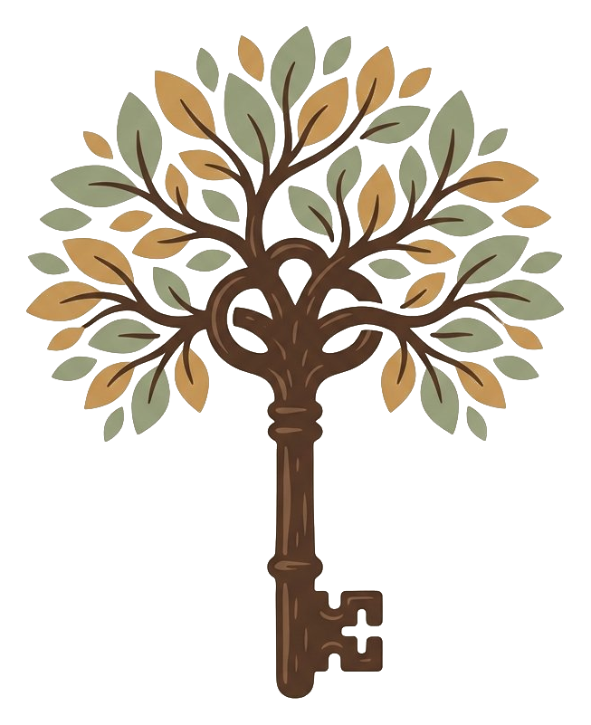
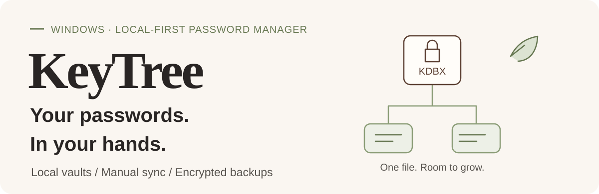
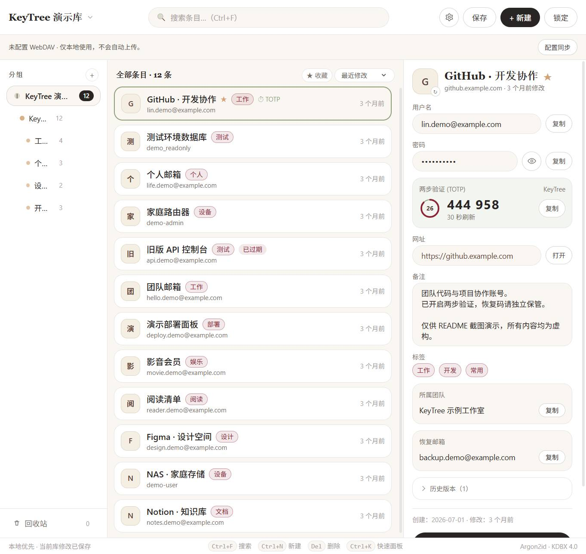
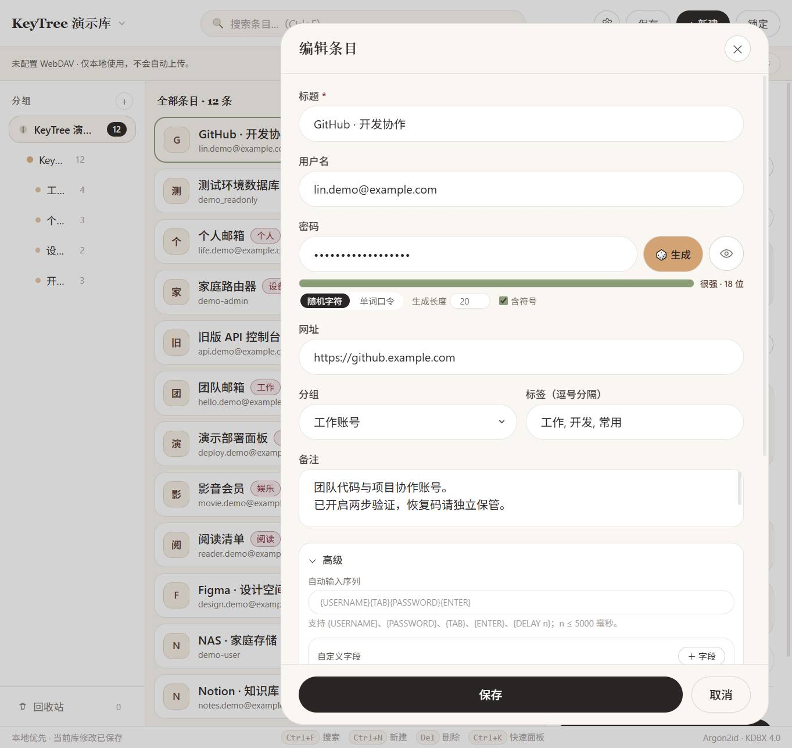
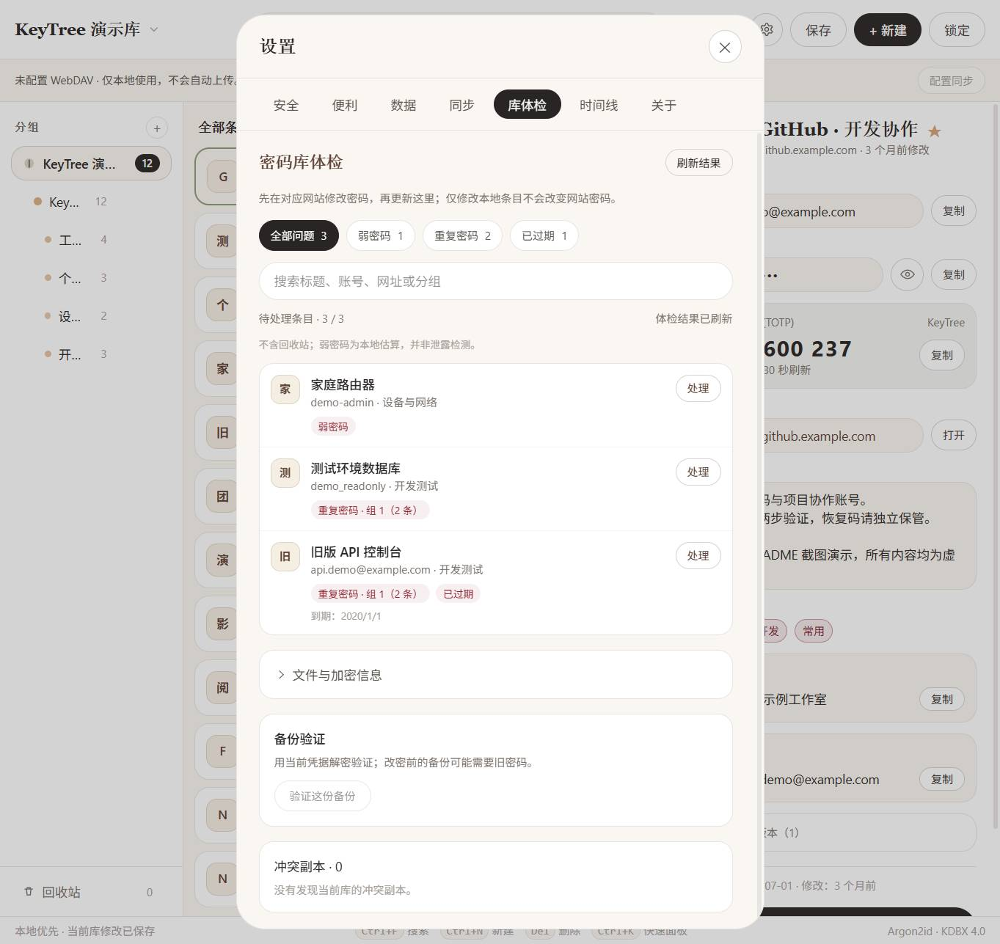
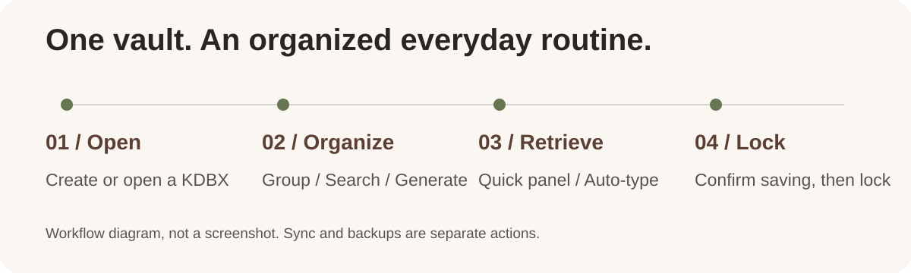
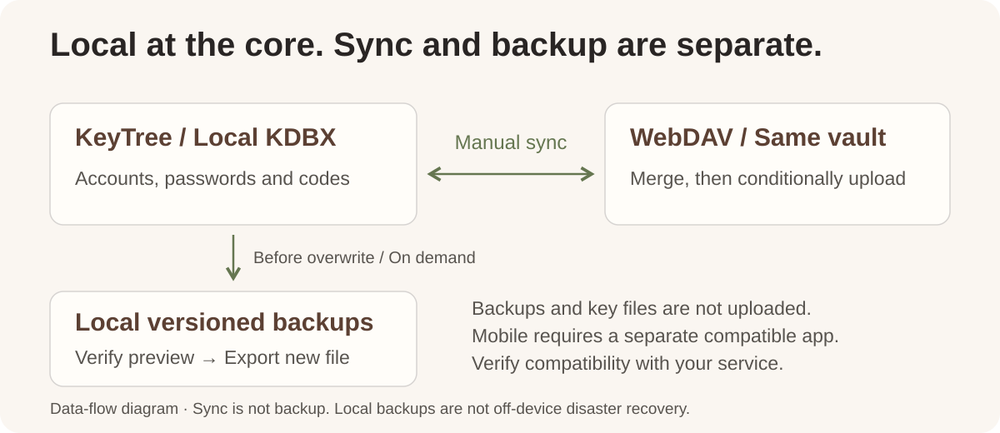

<p align="right">
  <a href="README.md"></a>
  <a href="README.en.md"></a>
</p>

<p align="center">
  
</p>

<p align="center">
  
</p>

<p align="center">
  <a href="https://github.com/JJong177/KeyTree/releases/download/v0.1.0/KeyTree-Setup.exe"></a>
  <a href="https://github.com/JJong177/KeyTree/releases/tag/v0.1.0"></a>
  <a href="https://linux.do/"></a>
</p>

<p align="center">
  <a href="#getting-started"></a>
  <a href="#sync-and-backups"></a>
  <a href="#development"></a>
</p>

**KeyTree** is a local-first password manager for Windows. Organize accounts, passwords and one-time codes in your own encrypted `.kdbx` file. Find entries with groups and search, then use the quick panel, copy actions or auto-type for everyday sign-ins.

**No cloud service is required to manage a local vault.** When you need access across devices, connect your own WebDAV service and manually sync the same encrypted file.

> Current version: **0.1.0** · Installer: **Windows x64**. Screenshots use fictional data; SVGs are conceptual diagrams. The current application UI is in Chinese. English installer text and this README do not imply an English application UI or verified compatibility with every service and mobile client.

## Interface preview

A separately created KDBX demo vault illustrates account management, search, TOTP, entry editing and vault health checks. **All accounts, passwords, domains and one-time codes shown are fictional and must not be used to sign in.**

<p align="center">
  
</p>

The entry list and details sit side by side. Passwords stay masked, with groups, search and one-time codes available in the same view.

<details>
<summary>Entry editor and password generator</summary>

<p align="center">
  
</p>

Edit account details, choose random passwords or passphrases, and organize groups and tags in one place.

</details>

<details>
<summary>Vault health: weak, reused and expired passwords</summary>

<p align="center">
  
</p>

Open **Settings → Vault health (设置 → 库体检)** to filter issues and edit affected entries. These problems were intentionally added to the demo vault; the report excludes the recycle bin.

Password strength is a local estimate, not a breach check. Change a password on its website first, then update the vault. Editing a local entry does not change the website password.

</details>

> **Screenshot scope:** captured from the current application frontend after actually decrypting a demo KDBX in an isolated environment. Native interfaces were adapted for isolation; no real accounts or cloud services were connected. These captures are not a complete native desktop acceptance test.

## From organization to everyday access

<p align="center">
  
</p>

### Keep accounts organized

Groups, tags, search and custom fields keep work and personal accounts in order. Entry history and the recycle bin help you revisit changes and recover deleted entries; recent vaults make switching convenient.

### Retrieve what you need

Generate random passwords or passphrases and store TOTP one-time codes. The quick panel, global shortcuts, copy actions and auto-type reduce repetitive input. Always check the target window and input focus before auto-type.

### Everyday safeguards

Windows Hello local quick unlock, idle locking, timed clipboard clearing and screenshot hiding are available. Other integrations include the system tray, optional launch at login, vault health checks and a local activity timeline.

## Getting started

### 1. Install KeyTree

Download [`KeyTree-Setup.exe` from GitHub Releases](https://github.com/JJong177/KeyTree/releases/download/v0.1.0/KeyTree-Setup.exe), follow the wizard and launch **KeyTree**. The installed app does not require Node.js, Rust or a development server. The installer is a Release attachment, not part of the source tree. To build it yourself, see Development below.

- **Runtime:** Microsoft Edge WebView2 Runtime. The installer attempts an online installation if it is missing.
- **Installer language:** Simplified Chinese or English. This changes the installation wizard only, not the application UI.
- **Download source:** the current installer is unsigned. Windows may display an unknown-publisher or SmartScreen warning. Download it from this project's GitHub Releases.

### 2. Create your first vault

Choose **New (新建)** to set a master password and save a `.kdbx` file, or **Open (打开)** to use an existing vault. An optional key file can also be used.

Add a test entry, try groups, search and copy, and confirm that saving succeeded. **Practice with a test vault and verify backup recovery before migrating important accounts.** If saving fails, retry or save a new copy rather than assuming the changes reached disk.

> Keep your master password and key file safe and independently backed up. Required credentials cannot be bypassed if lost. Windows Hello is not a cross-device replacement for your master password.

### 3. Import existing accounts

Go to **Settings → Data (设置 → 数据)** and select a Chrome, Edge or KeePassXC CSV export. Review the preview before confirming. Imports currently add new entries without overwriting existing ones.

Prefer a complete encrypted KDBX copy for exports. **CSV exports contain plaintext passwords** and are intended only for temporary migration, not sharing, uploading or routine backup storage.

## Sync and backups

<p align="center">
  
</p>

### Sync before and after switching devices

In **Settings → Sync (设置 → 同步)**, enter the full HTTPS `.kdbx` file URL, username and application-specific password. Save, run the read-only connection test, then click **Sync now (立即同步)**. A shortcut is also available in the main view.

Sync reads and verifies the same remote vault, merges it, saves locally and then performs a conditional upload. It stops if the remote version changes instead of overwriting unconditionally. **A local save does not mean the remote copy is up to date. There is no background automatic sync.**

For Jianguoyun, first upload the same current KDBX manually, then configure its WebDAV file URL—not a web sharing link. Do not let a cloud-drive client and built-in sync manage the same local file simultaneously.

Mobile devices require a separate client supporting KDBX and the relevant service; KeyTree has no mobile app. Sync before editing on another device and again afterward. Real-service and cross-device compatibility still require verification.

[WebDAV quick guide →](keytree/docs/webdav-sync.en.md)

### Keep previous versions; restore without overwriting

Open **Settings → Data → Versioned encrypted backups (设置 → 数据 → 多版本加密备份)**. KeyTree preserves the previous ciphertext before overwriting an existing valid KDBX; you can also back up the currently saved version manually.

Backups live next to the vault in `<vault filename>.keytree-backups`. Each vault retains at most **30 copies / 256 MiB total**, with a **64 MiB** limit per copy. To recover, verify a preview with the current credentials, then export to a new, nonexistent filename without replacing the original.

Built-in sync uploads the vault only—not the backup directory, key files, Hello cache, application settings or audit records. Transfer key files separately using a safe channel.

**Sync is not backup, and local backups are not off-device disaster recovery.** Older backups may require the old master password or key file. Keep another protected copy on an independent device.

[Backup and recovery quick guide →](keytree/docs/sync-and-backups.en.md)

## Security boundaries

KDBX encryption, Windows Hello and DPAPI-protected local credentials are safeguards, not absolute security guarantees. They cannot protect a system already controlled by malware.

### Encryption strength and high-security mode

New vaults default to **KDBX 4 / AES-256 / Argon2id (64 MiB, 3 iterations, parallelism 1)**. Opening or normally saving an existing vault does not automatically change its parameters.

In **Settings → Security → Vault encryption strength**, inspect the actual parameters, choose a 64 / 128 / 256 MiB minimum-cost profile, measure local derivation time, then confirm the upgrade. Higher existing Argon2 memory, iterations and parallelism are preserved, as is the data cipher; KDBX 3 is upgraded to KDBX 4. New ciphertext must pass an authenticated decrypt/reopen check and the current version must be backed up before a version-checked atomic write. Timing measures one derivation only. Higher costs also slow down saving, unlocking and syncing; verify your other KeePass clients separately.

Quick unlock is off for new installations; an explicit historical opt-in is preserved. **High-security mode** disables quick unlock and automatic Hello, and clears the local credential cache. Unlocking then requires the master password and any required key file. A cache-deletion failure is reported for retry, not treated as successful deletion. Quick unlock uses account-level DPAPI to cache the master password and optional key file, not hardware-bound encryption; normal exit clears it, but crashes may leave a cache behind.

**An upgrade only strengthens the current vault, not old backups, cloud history or other copies.** Sync manually when needed and do not delete backups before confirming recovery. Use a strong, unique master password and back up key files separately from the database.

- **Public master-password hints are plaintext metadata** and travel with the KDBX. Do not include passwords, keys or sensitive clues.
- Changing a master password or key file does not re-encrypt old backups, cloud history or other copies. Old credentials may still open them.
- Idle locking, clipboard clearing and screenshot hiding are auxiliary protections, not guarantees against all capture or disclosure.
- No third-party security audit is provided. Conditional uploads to real services, mobile merging and metadata preservation require separate verification.

## Development

Frontend: **Vue 3 / TypeScript / Vite / Tailwind CSS / Radix Vue**. Desktop layer: **Tauri 2 / Rust**. KDBX operations use the vendored `kdbxweb` with Argon2 support.

On Windows, prepare Node.js 22 LTS, npm, Rust stable with MSVC, Visual Studio C++ desktop build tools, the Windows SDK and WebView2. Node.js 22 is a recommended environment, not a claimed minimum. See the [Tauri prerequisites](https://v2.tauri.app/start/prerequisites/).

From the repository root:

```powershell
cd keytree
npm ci
npm run tauri -- dev
```

Application sources are in `keytree`. `npm run dev` previews the frontend only; a regular browser cannot replace native desktop validation.

<details>
<summary>Tests, packaging and repository layout</summary>

Run these from `keytree`:

```powershell
# Frontend regression scripts
npm test

# Type checking and frontend build
npm run build

# Rust tests
cargo test --manifest-path src-tauri/Cargo.toml

# Desktop release build
npm run tauri -- build
```

Default bundle output: `keytree/src-tauri/target/release/bundle/`. These commands document the workflow; they do not claim that every documentation update reruns all tests or installer checks.

```text
.
├── README.md                 # Chinese project homepage
├── README.en.md              # English project homepage
├── assets/readme/            # README visuals and screenshots
└── keytree/
    ├── assets/               # Product logo
    ├── src/
    │   ├── components/       # Vault, entry and settings UI
    │   ├── composables/      # Vault state, locking and sync coordination
    │   ├── lib/              # Search, TOTP, import and utilities
    │   └── kdbx/             # KDBX and Argon2 integration
    ├── src-tauri/            # Rust native layer and packaging
    ├── vendor/kdbxweb/       # Vendored KDBX dependency
    ├── scripts/              # Development and regression scripts
    └── docs/                 # Sync and backup quick guides
```

</details>

## License

MIT. See [LICENSE](LICENSE).
