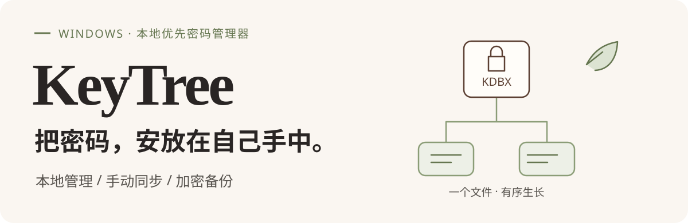
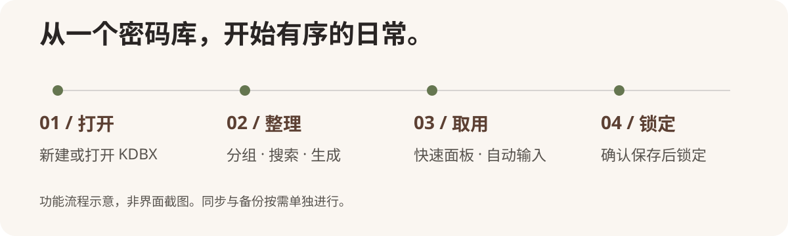
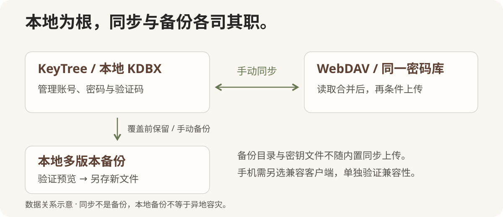

<p align="right"><strong>简体中文</strong> · <a href="README.en.md">English</a></p>

<p align="center">
  
</p>

<p align="center">
  
</p>

<p align="center">
  <a href="https://github.com/JJong177/KeyTree/releases/download/v0.1.0/KeyTree-Setup.exe"><strong>⬇ 下载 Windows x64 安装包 · v0.1.0</strong></a><br />
  <a href="https://github.com/JJong177/KeyTree/releases/tag/v0.1.0">发布说明</a>
</p>

<p align="center">
  <a href="#开始使用">开始使用</a> ·
  <a href="#同步与备份">同步与备份</a> ·
  <a href="#开发与构建">开发与构建</a>
</p>

**KeyTree** 是一款面向 Windows 的本地优先密码管理器。把账号、密码和动态验证码整理在自己的 `.kdbx` 加密文件中，通过分组与搜索找到它们，用快速面板、复制或自动输入完成日常登录。

**不配置云服务，也能管理本地密码库。** 需要跨设备使用时，再连接自己的 WebDAV 服务，手动同步同一份加密文件。

> 当前版本 **0.1.0** · 安装包面向 **Windows x64**。界面截图使用虚构演示数据，SVG 图解为功能示意；不代表所有网盘和手机客户端已经通过兼容性验收。

## 界面预览

使用独立创建的 KDBX 演示库，展示账号管理、搜索、TOTP、条目编辑与密码库体检。**所有账号、密码、域名和验证码均为虚构示例，不可用于登录。**

<p align="center">
  
</p>

账号列表与详情并排展示，密码保持隐藏；分组、搜索和动态验证码集中在同一界面。

<details>
<summary>查看条目编辑与密码生成</summary>

<p align="center">
  
</p>

在同一处编辑账号信息、选择随机密码或口令短语生成方式，并整理分组与标签。

</details>

<details>
<summary>查看密码库体检：弱密码、重复密码与过期提醒</summary>

<p align="center">
  
</p>

在 **设置 → 库体检** 查看弱密码、重复密码和已过期条目，按问题类型筛选并进入编辑。演示库故意设置了这些问题，用于展示检测结果；不包含回收站条目。

弱密码为本地估算，不是泄露检测。请先在对应网站修改密码，再更新密码库；仅修改本地条目不会改变网站密码。

</details>

> **截图说明：** 来自当前应用前端，在隔离环境中实际解密演示 KDBX；原生接口仅作隔离适配，未连接真实账户或网盘，不代表桌面原生功能验收。

## 从整理到取用，少一点重复操作

<p align="center">
  
</p>

### 有序整理

分组、标签、搜索与自定义字段，让工作和个人账号各归其位。条目历史与回收站帮助回看修改、找回误删；最近使用的密码库方便切换。

### 顺手取用

生成随机密码或口令短语，保存 TOTP 动态验证码；通过快速面板、全局快捷键、字段复制和自动输入减少重复操作。自动输入前，请先核对目标窗口与焦点。

### 贴近日常的保护

支持 Windows Hello 本机快速解锁、空闲自动锁定、剪贴板定时清理和截图隐藏设置。还提供托盘、可选开机自启、密码库体检与本机操作时间线。

## 开始使用

### 1. 安装 KeyTree

从 [GitHub Releases 下载 `KeyTree-Setup.exe`](https://github.com/JJong177/KeyTree/releases/download/v0.1.0/KeyTree-Setup.exe)，按向导安装后启动 **KeyTree**。安装版无需 Node.js、Rust 或开发服务器。安装包作为 Release 附件提供，不放在源码目录中；自行构建见下方“开发与构建”。

- **系统依赖：** Microsoft Edge WebView2 Runtime；缺少时安装器会尝试联网补装。
- **安装语言：** 简体中文或 English，仅影响安装向导，不改变应用界面语言。
- **来源提醒：** 当前安装包未签名，Windows 可能提示“未知发布者”或 SmartScreen 警告。请从本项目的 GitHub Releases 下载。

### 2. 建立第一个密码库

在启动页选择“新建”，设置主密码并保存 `.kdbx` 文件；已有密码库可直接选择“打开”，也可配合密钥文件使用。

添加一个测试账号，试试分组、搜索与复制，再确认保存状态。**建议先用测试库熟悉操作，并验证备份恢复，再迁移重要账号。** 保存失败时应重试或另存，不要假定修改已经落盘。

> 主密码与密钥文件请独立妥善保管。遗失所需凭据后，不能绕过加密恢复数据；Windows Hello 不是跨设备的主密码替代品。

### 3. 迁移已有账号

进入 **设置 → 数据**，选择 Chrome、Edge 或 KeePassXC 的 CSV 文件，核对导入预览后确认。当前导入只新增条目，不覆盖已有条目。

导出时优先使用完整的加密 KDBX 副本。**CSV 含明文密码**，仅适合临时迁移，不应分享、上传或作为日常备份保存。

## 同步与备份

<p align="center">
  
</p>

### 同步：换设备前后，主动确认一次

在 **设置 → 同步** 填写完整的 HTTPS `.kdbx` 文件地址、用户名与应用专用密码。保存后先做只读连接测试，再点击“立即同步”；主界面也提供快捷入口。

同步会读取远端、验证同一库、合并并保存本地，再条件上传。远端版本变化时停止，不进行无条件覆盖。**本地已保存，不等于远端已更新；当前没有后台自动同步。**

使用坚果云时，先手动上传当前同一份 KDBX，再配置它的 WebDAV 文件地址，不能使用网页分享链接。不要让云盘客户端与内置同步同时管理同一本地文件。

手机需另选支持 KDBX 和对应服务的客户端；KeyTree 本身不提供手机版。换设备编辑前先同步，编辑完再同步。真实服务和跨设备兼容性仍需单独验证。

[阅读 WebDAV 同步指南 →](keytree/docs/webdav-sync.md)

### 备份：保留旧版，恢复时不覆盖原库

入口：**设置 → 数据 → 多版本加密备份**。覆盖已有有效 KDBX 前保留上一版密文，也可手动备份当前已保存版本。

备份位于库文件旁的 `<库文件名>.keytree-backups` 目录；单库最多保留 **30 份、合计 256 MiB**，单份上限 **64 MiB**。恢复时先用当前凭据验证预览，再另存为不存在的新文件，不覆盖原库。

内置同步只上传库文件，不上传备份目录、密钥文件、Hello 缓存、应用设置或审计记录。密钥文件需要独立安全传递。

**同步不是备份，本地备份不等于异地容灾。** 旧备份可能仍需旧主密码或旧密钥文件；重要密码库应在独立设备另存受保护的副本。

[阅读备份与恢复说明 →](keytree/docs/sync-and-backups.md)

## 安全边界，提前说清楚

KDBX 加密、Windows Hello 和 DPAPI 本机凭据保护是安全措施，不是绝对安全承诺，也不能保护已被恶意软件控制的系统。

- **公开主密码提示是明文元数据**，会随 KDBX 传播，不要写入密码、密钥或敏感线索。
- 更换主密码或密钥文件，不会重新加密旧备份、云端历史和其他副本；旧凭据仍可能打开它们。
- 自动锁定、剪贴板清理与截图隐藏是辅助保护，不保证阻止所有截取或泄露。
- 当前未提供第三方安全审计证明；真实网盘条件上传、手机端合并与元数据保留仍需单独验收。

## 开发与构建

前端：**Vue 3 / TypeScript / Vite / Tailwind CSS / Radix Vue**。桌面层：**Tauri 2 / Rust**。KDBX 读写基于仓库内的 `kdbxweb`，配合 Argon2 实现。

建议在 Windows 上准备 Node.js 22 LTS、npm、Rust stable（MSVC 工具链）、Visual Studio C++ 桌面开发组件、Windows SDK 与 WebView2。Node.js 版本为建议环境，非最低版本承诺；系统依赖详见 [Tauri 官方说明](https://v2.tauri.app/start/prerequisites/)。

在仓库根目录执行：

```powershell
cd keytree
npm ci
npm run tauri -- dev
```

应用源码位于 `keytree` 目录。仅运行 `npm run dev` 可预览前端，但普通浏览器不能替代原生功能验收。

<details>
<summary>测试命令、发布构建与项目结构</summary>

以下命令均在 `keytree` 目录执行：

```powershell
# 前端回归脚本
npm test

# TypeScript 类型检查与前端构建
npm run build

# Rust 测试
cargo test --manifest-path src-tauri/Cargo.toml

# 桌面发布构建
npm run tauri -- build
```

默认桌面打包产物位于 `keytree/src-tauri/target/release/bundle/`。以上是开发命令，不代表本文更新时重新执行过全部测试或安装验收。

```text
.
├── README.md                 # 中文项目首页
├── README.en.md              # 英文项目首页
├── assets/readme/            # README 品牌首图
└── keytree/
    ├── assets/               # 产品 Logo
    ├── src/
    │   ├── components/       # 条目、密码库与设置界面
    │   ├── composables/      # 密码库状态、锁定与同步协调
    │   ├── lib/              # 搜索、TOTP、导入等逻辑
    │   └── kdbx/             # KDBX 与 Argon2 集成
    ├── src-tauri/            # Rust 原生层与打包配置
    ├── vendor/kdbxweb/       # 本地 KDBX 依赖
    ├── scripts/              # 开发与回归脚本
    └── docs/                 # 同步、备份说明与流程图
```

</details>

## 反馈

反馈问题时，请提供应用版本、Windows 版本、复现步骤和脱敏错误信息。**不要提交真实密码库、主密码、密钥文件、WebDAV 授权密码或含敏感字段的截图。**

## 许可

MIT，见 [LICENSE](LICENSE)。

<p align="center">
  <a href="https://linux.do/"></a>
</p>
